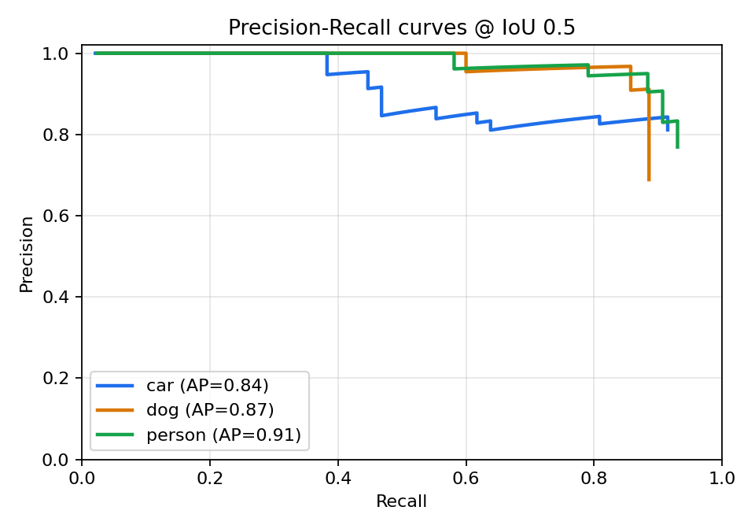
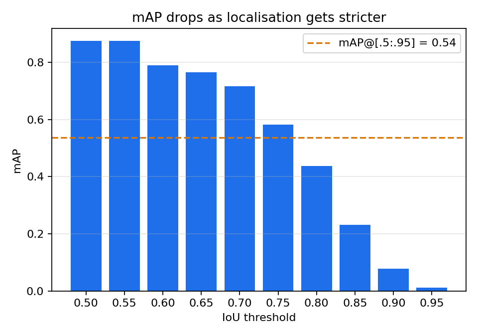
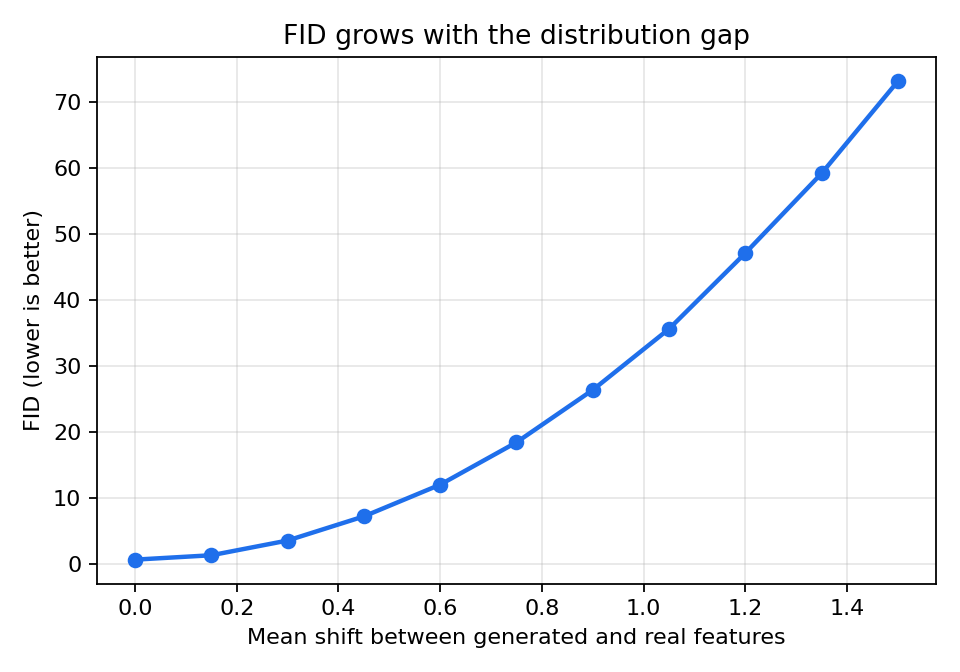

# Evaluation Metrics for Computer Vision: OCR, Object Detection, Image Generation

Master Data & IA, INPT, 2026. Homework: *Evaluation Metrics for Computer Vision Tasks*.

This repository has small, dependency-light Python implementations of the main
evaluation metrics for three tasks. Each module can run on its own and comes
with a demo on synthetic data, so you can see how each metric reacts to typical errors.

| Task | Metrics implemented | File |
|------|--------------------|------|
| OCR | Levenshtein distance, **CER**, **WER**, exact-match accuracy, text normalisation | `ocr/ocr_metrics.py` |
| Object detection | **IoU**, TP/FP matching, **Precision-Recall curve**, **AP** (VOC all-point & COCO 101-point), **mAP@0.5**, **mAP@0.75**, **mAP@[0.5:0.95]** | `object_detection/detection_metrics.py` |
| Image generation | **Inception Score (IS)**, **FID**, **KID**, improved **Precision / Recall** | `image_generation/generation_metrics.py` |

## Repository structure

```text
.
├── ocr/
│   └── ocr_metrics.py              # CER, WER, exact match
├── object_detection/
│   └── detection_metrics.py        # IoU, PR curve, AP, mAP (VOC / COCO)
├── image_generation/
│   └── generation_metrics.py       # IS, FID, KID, precision / recall
├── figures/                        # figures produced by run_all.py
├── run_all.py                      # runs every demo
├── requirements.txt
└── README.md
```

## Installation

Requires Python ≥ 3.8. No GPU and no model download needed: everything runs on CPU in a few seconds.

**Windows (PowerShell)**

```powershell
git clone https://github.com/ingmouhssinechkarka-ctrl/Evaluation-Metrics-for-C.V-Tasks.git
cd Evaluation-Metrics-for-C.V-Tasks
python -m venv .venv
.\.venv\Scripts\Activate.ps1      # if blocked: Set-ExecutionPolicy -Scope CurrentUser RemoteSigned
pip install -r requirements.txt
python run_all.py
```

**Linux / macOS**

```bash
git clone https://github.com/ingmouhssinechkarka-ctrl/Evaluation-Metrics-for-C.V-Tasks.git
cd Evaluation-Metrics-for-C.V-Tasks
python3 -m venv .venv
source .venv/bin/activate
pip install -r requirements.txt
python run_all.py
```

The source files contain detailed comments (in French) explaining the concept
behind every step of each metric.

## Usage

Run every demo and regenerate the figures in `figures/`:

```bash
python run_all.py
```

Or run one task at a time:

```bash
python ocr/ocr_metrics.py
python object_detection/detection_metrics.py
python image_generation/generation_metrics.py
```

### Using the functions on your own data

```python
import sys
sys.path[:0] = ["ocr", "object_detection", "image_generation"]

from ocr_metrics import cer, wer
cer(["hello world"], ["helo world"])          # 0.0909

from detection_metrics import iou, mean_ap, coco_map
iou([0, 0, 10, 10], [5, 5, 15, 15])           # 0.1429
# preds: [{"image": 0, "cls": "car", "box": [x1, y1, x2, y2], "score": 0.9}, ...]
# gts:   [{"image": 0, "cls": "car", "box": [x1, y1, x2, y2]}, ...]
mean_ap(preds, gts, iou_thr=0.5)              # (mAP, {class: AP})
coco_map(preds, gts)                          # mAP@[0.5:0.95]

from generation_metrics import frechet_distance, inception_score
frechet_distance(real_features, fake_features)  # (N, D) arrays, e.g. InceptionV3 pool3
inception_score(class_probabilities)            # (N, C) softmax outputs
```

## Source code documentation

### `ocr/ocr_metrics.py`

| Function | Description |
|----------|-------------|
| `levenshtein(ref, hyp)` | Dynamic-programming edit distance. Returns `(distance, S, D, I)`, the substitutions, deletions and insertions. Works on strings (characters) or lists (words). |
| `normalize(text, lower, strip_accents, collapse_spaces)` | Optional normalisation before scoring. Scores are only comparable when the normalisation is the same. |
| `cer(refs, hyps)` | Corpus-level Character Error Rate = Σ char edits / Σ reference characters. It can exceed 1 when there are many insertions. |
| `wer(refs, hyps)` | Corpus-level Word Error Rate = Σ word edits / Σ reference words. |
| `exact_match(refs, hyps)` | Share of lines (or fields) that are recognised perfectly. |
| `demo()` | Scores four simulated OCR lines with common errors (`l`→`1`, `0`→`O`, merged words, case). |

**Demo output:** CER = 4.46 %, WER = 40 %, exact match = 25 %. A few character
errors are enough to break many words, so WER is always much harsher than CER.

### `object_detection/detection_metrics.py`

| Function | Description |
|----------|-------------|
| `iou(a, b)` | Intersection over Union of two `[x1, y1, x2, y2]` boxes. |
| `match(preds, gts, cls, iou_thr)` | Sorts predictions by score. Each one becomes a TP if it overlaps a not-yet-matched GT with IoU ≥ threshold, otherwise an FP (duplicates are FPs). |
| `pr_curve(tps, n_gt)` | Cumulative precision `TP/(TP+FP)` and recall `TP/N_gt` as the confidence threshold decreases. |
| `average_precision(p, r, method)` | Area under the interpolated PR curve: `"voc"` = all-point interpolation, `"coco"` = mean over 101 recall points. |
| `mean_ap(preds, gts, iou_thr, method)` | Mean of the per-class APs at one IoU threshold. |
| `coco_map(preds, gts)` | COCO primary metric: mAP averaged over IoU = 0.50, 0.55, …, 0.95. |
| `make_synthetic_dataset()` | 50 images, 3 classes, a detector with localisation noise, 12 % misses and random false positives. |
| `demo(fig_dir)` | Prints the metrics and saves `pr_curves.png` and `map_vs_iou.png`. |

**Demo output:** mAP@0.5 = 0.875, mAP@0.75 = 0.581, mAP@[0.5:0.95] = 0.536.
The same detector looks very different depending on how strict localisation is.

### `image_generation/generation_metrics.py`

| Function | Description |
|----------|-------------|
| `inception_score(probs)` | `IS = exp(E_x KL(p(y|x) ‖ p(y)))`. Higher is better. It rewards confident (sharp) and varied (diverse) predictions. It does not use real images. |
| `frechet_distance(real, fake)` | `FID = ‖μr − μg‖² + Tr(Σr + Σg − 2(ΣrΣg)^½)`. Fréchet distance between Gaussians fitted to the features. Lower is better. |
| `kernel_inception_distance(real, fake)` | Unbiased MMD² with the cubic polynomial kernel, averaged over subsets. More reliable than FID for small samples. |
| `precision_recall(real, fake, k)` | Improved precision (fidelity) and recall (diversity), using k-NN manifolds (Kynkäänniemi et al., 2019). |
| `demo(fig_dir)` | Compares four simulated generators and saves `fid_vs_shift.png`. |

**Demo output:**

| Generator | FID ↓ | KID ↓ | Precision ↑ | Recall ↑ |
|-----------|------:|------:|------------:|---------:|
| good | 0.68 | 0.011 | 0.81 | 0.83 |
| shifted (low quality) | 11.66 | 1.523 | 0.45 | 0.48 |
| mode collapse | 13.56 | 0.070 | **1.00** | **0.00** |
| very bad | 105.94 | 41.78 | 0.00 | 0.98 |

FID gives one number. Precision/Recall show *why* a model is bad: in mode
collapse the samples are realistic (precision 1.0) but cover none of the real diversity (recall 0.0).

> **Note:** the demo uses synthetic Gaussian features so it runs in seconds
> without a GPU. With real images, extract InceptionV3 features (for example with
> [`pytorch-fid`](https://github.com/mseitzer/pytorch-fid) or `torchmetrics`) and
> pass them to the same functions. FID needs a large sample (≥ 10k images
> recommended), otherwise it is biased upwards.

## Figures

| | |
|---|---|
|  |  |
|  | |

## References

- Levenshtein, V. I. (1966). *Binary codes capable of correcting deletions, insertions and reversals.*
- Everingham et al. (2010). *The PASCAL Visual Object Classes (VOC) Challenge.* IJCV.
- Lin et al. (2014). *Microsoft COCO: Common Objects in Context.* ECCV.
- Salimans et al. (2016). *Improved Techniques for Training GANs* (Inception Score).
- Heusel et al. (2017). *GANs Trained by a Two Time-Scale Update Rule Converge to a Local Nash Equilibrium* (FID).
- Bińkowski et al. (2018). *Demystifying MMD GANs* (KID).
- Kynkäänniemi et al. (2019). *Improved Precision and Recall Metric for Assessing Generative Models.*
- Hessel et al. (2021). *CLIPScore: A Reference-free Evaluation Metric for Image Captioning.*
